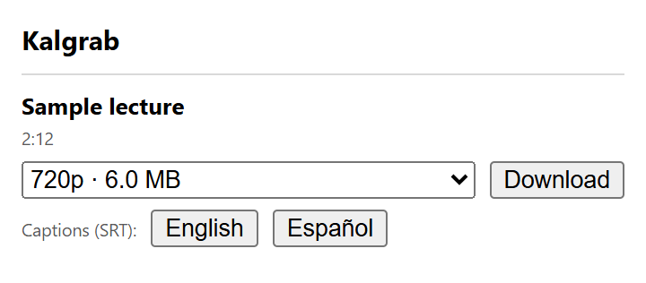

# Kalgrab

[](https://github.com/diegocancelac/kalgrab/actions/workflows/ci.yml)
[](LICENSE)
[](https://github.com/diegocancelac/kalgrab/releases/latest)

Chromium extension (Manifest V3) that downloads videos from Kaltura players, including
players embedded in cross-origin iframes such as Kaltura KAF inside an LMS.



Click the Kalgrab icon on a page with a Kaltura video and the popup lists the videos it
finds, with their duration and the available MP4 qualities and file sizes. Pick a quality
and Chrome's Save As dialog opens with the video title as the file name. Caption tracks can
be saved as SRT files the same way.

The screenshot comes from a local test page with sample data.

## Install

Kalgrab is not in the Chrome Web Store.

1. Download `kalgrab-<version>-chrome.zip` from the
   [latest release](../../releases/latest) and unzip it.
2. Open `chrome://extensions` and turn on Developer mode.
3. Click "Load unpacked" and select the unzipped folder.

To update, replace the folder with the new release and click the reload button on the
extension's card.

## First use

1. Open the page with the video and wait for the player to load.
2. Click the Kalgrab icon. The first time, the popup asks for site access: click "Allow
   access" and accept Chrome's prompt (see [Permissions](#permissions) for why it covers all
   sites). If the popup closes when the prompt appears, click the icon again.
3. Pick a quality and click "Download", or click a language under "Captions (SRT)".
   Choose where to save the file in the dialog. Cancelling the dialog cancels the download.

If no videos are listed and the page is still loading, wait and click the icon again.

## How it works

Kalgrab only runs when you click its icon. It has no content scripts in its manifest, does
not observe network traffic, does not poll and stores nothing.

1. When the popup opens, the background runs a script in every frame of the current tab
   with `scripting.executeScript`, in the page's own JavaScript context. In frames with a
   Kaltura Player v7 it reads the player's configuration (partner id, API URL, session) and
   asks that Kaltura API for the entry's playback context, the same request the player makes.
2. The popup lists each video with its MP4 qualities. Videos with DRM, encrypted streams or
   an access-control rule that blocks them are listed with the reason and cannot be
   downloaded.
3. On download, the background reads the player's current session from the same frame,
   adds it to the MP4 URL and hands the URL to Chrome's download manager. Captions are
   fetched as WebVTT from the same API and converted to SRT.

The Kaltura session token (`ks`) is only sent to the Kaltura origins the player itself uses.
Kalgrab never logs or stores it, and the list shown in the popup does not contain it. Like
any other download, the URL stays in Chrome's download history; Kaltura sessions expire
after a few hours.

[docs/DESIGN.md](docs/DESIGN.md) explains the design decisions: why it only runs on click,
how page data is validated, and where the session token may go.

### Compared with other video downloaders

Many downloaders only see a video once it starts playing, because they watch the page's
network requests, and some save HLS streams as `.ts` segment files. Kalgrab asks the Kaltura
API for the sources the player knows about, so the video does not have to be played, and
saves the progressive MP4 that Kaltura serves, in the quality you choose.

## Permissions

| Permission           | Why                                                                                     |
| -------------------- | --------------------------------------------------------------------------------------- |
| `*://*/*` (optional) | Run the detection script in the player's iframe. Requested from the popup on first use. |
| `scripting`          | Run the detection script in the current tab when the icon is clicked.                   |
| `downloads`          | Save videos and captions.                                                               |

No host access is requested at install time. Site access is optional and can be revoked
from Chrome's settings. Even with it granted, nothing runs on a page until you click the
Kalgrab icon.

Why all sites instead of only the player's site: in an LMS, the player usually lives in a
cross-origin iframe. With LTI 1.3, that iframe starts on the LMS's own launch URL and only
reaches the Kaltura (KAF) site after several redirects and a form submission. Until Kalgrab
has access to that iframe, the page does not reveal which site it ended up on, so there is
no specific site to ask for. `activeTab` only covers the top-level page. The
`webNavigation` permission would reveal the frame's site, but Chrome shows it as "Read your
browsing history", which is a broader warning than the problem it would solve. See
[docs/DESIGN.md](docs/DESIGN.md#why-access-to-all-sites) and
[issue #17](https://github.com/diegocancelac/kalgrab/issues/17).

## Limitations

- Only Kaltura Player v7 is supported. Players using the legacy v2 embed (`kWidget`) are
  not detected yet.
- Only videos with a progressive MP4 source can be downloaded. Videos that Kaltura only
  serves as HLS or DASH are listed as "This video has no MP4 download"; HLS support is
  planned.
- Caption download is covered by tests but has not yet been verified with a real video.
- Chromium browsers only.

## Development

Requires Node.js 24 and pnpm (version pinned in `package.json`).

```sh
pnpm install
pnpm dev        # Chromium with the extension loaded and hot reload
pnpm lint
pnpm typecheck
pnpm test
pnpm build      # output in .output/chrome-mv3
pnpm build:dev  # output in .output/chrome-mv3-dev, with traces in the service worker console
pnpm zip
```

The traces in `pnpm dev` and `pnpm build:dev` builds follow each scan and download step
(frames, message types, validation, response) without session tokens or URLs. Production
builds leave them out.

Development builds also declare `*://*/*` in `host_permissions`, so they have site access
from install. Production builds only list it as optional; `pnpm check:manifest` (run in
CI) fails if the production manifest declares `host_permissions`.

Releases are built by CI when a `v*` tag matching the `package.json` version is pushed.

Test fixtures in `tests/fixtures` are sanitized captures. Never commit HAR files, tokens,
cookies or real user or course data.

## Responsible use

Kalgrab is meant for personal use, such as watching course recordings offline. You are
responsible for complying with copyright law, the content owner's terms and your
institution's policies. Do not redistribute content you do not have rights to. Kalgrab does
not and will not bypass DRM or encryption.

Kalgrab is not affiliated with or endorsed by Kaltura.

## License

[MIT](LICENSE)
